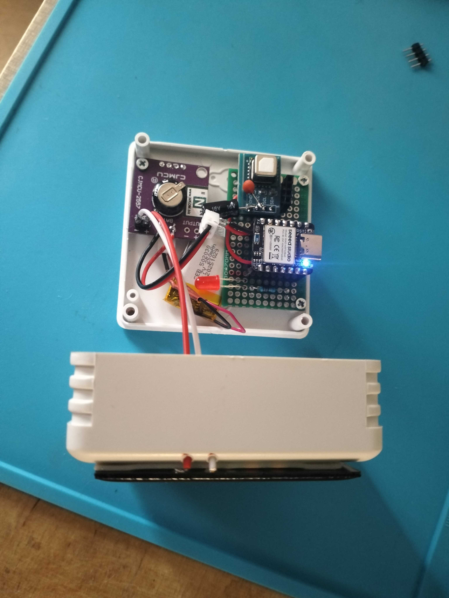
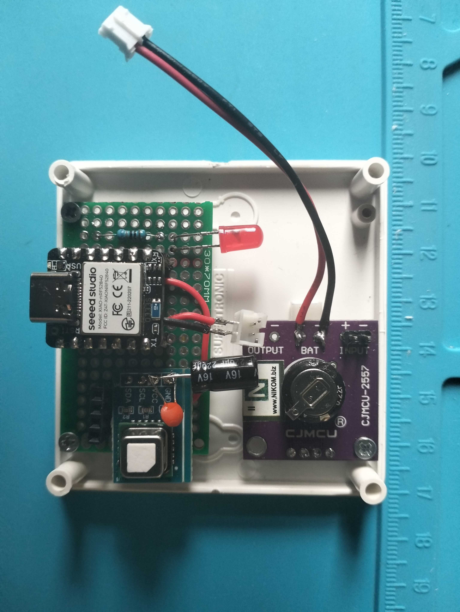
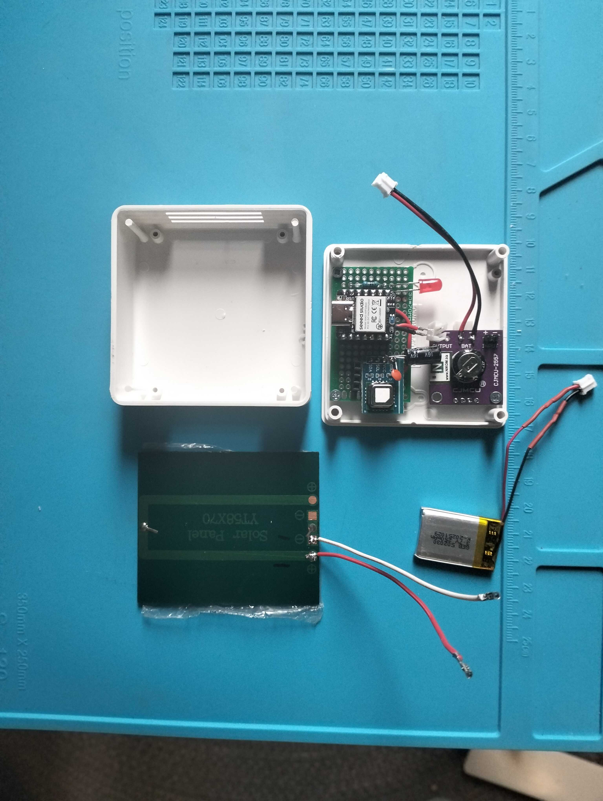

# co2check

A small solar-harvesting CO₂ monitor. It measures CO₂, temperature and humidity
every few minutes, broadcasts the readings over Bluetooth LE in the
[BTHome v2](https://bthome.io/) format (so Home Assistant picks it up with no
pairing), and blinks a red LED when the air in the room gets stale. A small
solar panel on the lid tops up a Li-ion cell, so the device is meant to run
indoors without ever being plugged in.



## Hardware

| Part | Role |
|---|---|
| Seeed Studio XIAO nRF52840 | MCU + BLE radio |
| Sensirion SCD41 (breakout) | Photoacoustic CO₂, temperature, humidity over I²C |
| CJMCU-2557 (TI BQ25570) | Solar energy harvester / cell charger |
| 58×70 mm 2.5 V solar panel | Energy source, mounted on the lid |
| 250 mAh 3.7 V Li-ion cell | System supply for the sensor's current bursts |
| 220 µF bulk capacitor | Next to the SCD41, absorbs its ~205 mA measurement peak |
| Red LED + resistor on D7 | High-CO₂ alert |

The XIAO, SCD41 and LED sit on a small perfboard; the harvester is a separate
board so it can be reused. The cell, not the harvester, powers the system: the
SCD41 draws about 205 mA during a CO₂ measurement, while the BQ25570 buck can
only supply about 110 mA, so the harvester only trickle-charges the cell.





## How it works

The firmware (`src/main.cpp`, tunables in `include/config.h`) is a small state
machine that spends almost all its time asleep:

1. **Warm-up / measure** – wakes the SCD41, discards the first single-shot
   reading, takes a real one, then powers the sensor down again.
2. **Transmit** – sends one BTHome v2 advertisement (~2 s window) as `co2m`
   with temperature, humidity, cell voltage, CO₂, a *battery low* flag and a
   *problem* flag for sensor errors.
3. **Wait** – picks the next state from the last sample:

| State | When | Behaviour |
|---|---|---|
| `IDLE` | normal | measure every 5 min |
| `ALERT` | CO₂ ≥ 1200 ppm (clears at ≤ 1000 ppm) | 5 min cadence, LED blinks 3× every 5 s |
| `SAVE_BAT` | cell ≤ 3.60 V (clears at ≥ 3.75 V) | measure every 30 min |
| `HIBERNATE` | cell ≤ 3.20 V (clears at ≥ 3.50 V) | no measuring, advertises voltage only every 30 min |

Every threshold has hysteresis so a value sitting on the edge can't make the
device flap between states. The alert outranks power saving, but not
hibernation. A hardware watchdog (30 s) guards the whole loop, and the sensor is
re-initialised after three failed readings. SCD41 automatic self-calibration is
enabled, so the device needs regular exposure to fresh air (~400 ppm) to stay
accurate.

## Building and flashing

The project uses [PlatformIO](https://platformio.org/) with Seeed's
nRF52 platform (pinned in `platformio.ini`).

```sh
pio run                 # build
pio run -t upload       # flash over USB (double-tap RESET if the port isn't found)
pio device monitor      # serial log at 115200 baud
```

For bench testing, lower `INTERVAL_NORMAL_MS` in `include/config.h` (e.g. to
one minute).

## Receiving the data

Any BTHome v2 receiver works. In Home Assistant, the BTHome integration
discovers the device automatically as `co2m` once a Bluetooth adapter or
ESPHome Bluetooth proxy is in range.

## Notes

- The BQ25570 is not a proper CC/CV Li-ion charger; set its `VBAT_OV` to about
  4.0–4.1 V and check the CJMCU-2557 divider rather than trusting it.
- With USB plugged in, the XIAO's own charger and the harvester both feed the
  cell.
- The SCD41 is sensitive to ESD at its opening: remove the protective sticker
  only while grounded and with the board unpowered. The first sensor in this
  build lost its CO₂ channel this way (temperature and humidity still worked).
